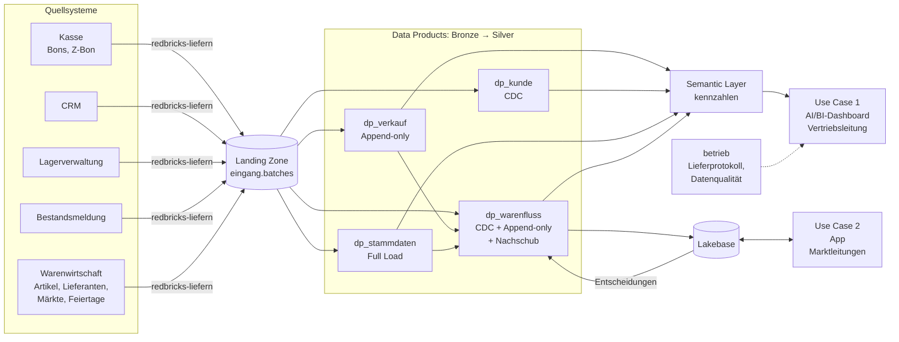

# Zielarchitektur redbricks Data Platform

Übersicht über Quellen, Data Products und Use Cases. Entscheidungen: ADR 0004, 0006, 0007.

## Data Products

| Data Product | Owner | Quellen | Lademuster |
|---|---|---|---|
| `dp_verkauf` | Vertrieb | Kasse: Bons, Z-Bon | Append-only |
| `dp_kunde` | Kundenmanagement | CRM | CDC |
| `dp_stammdaten` | Warenwirtschaft | Artikel, Lieferanten, Märkte, Feiertage | Full Load |
| `dp_warenfluss` | Logistik und Disposition | Lagerverwaltung, Bestand | CDC, Append-only |

## Schichten je Data Product

| Präfix | Schicht | Sichtbarkeit |
|---|---|---|
| `bronze_` | Rohdaten mit Herkunft, unverändert | intern |
| `quarantine_` | fehlerhafte Datensätze mit Grund | intern |
| `silver_` | bereinigt, nach Fachregeln | **veröffentlicht** |
| `gold_` | nutzerorientierte Ergebnisse (Nachschub) | **veröffentlicht** |